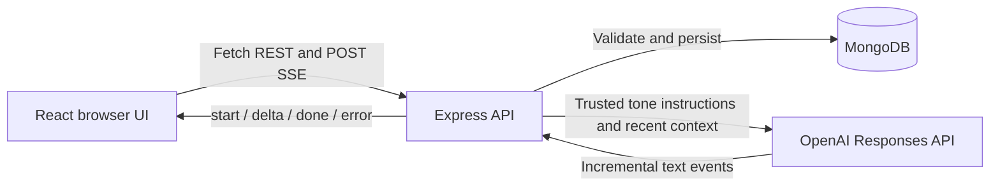

# AI Chat Assistant

A single-user, full-stack chat application with persistent conversations, real OpenAI streaming, and server-enforced communication tones. Built for local evaluation and technical interviews. There is no authentication: run it on localhost or behind private access controls, not as an unrestricted public service.

## Features and stack

- React + TypeScript + Vite, Tailwind CSS, Lucide icons, Context API and native Fetch.
- Responsive history sidebar, conversation deletion, light/dark themes, timestamps, safe Markdown/code rendering and message copying.
- Professional, Casual and Concise tones persisted per conversation; changes affect subsequent AI requests.
- Node + Express + TypeScript, Mongoose, official OpenAI SDK, Zod, dotenv, Helmet, CORS and basic AI rate limiting.
- Genuine incremental SSE delivery, smooth text presentation, cancellation, bounded timeouts, recoverable failed prompts and request-ID deduplication.
- MongoDB persistence with per-conversation database leases to prevent competing generations.
- Regenerate the latest completed answer using the current tone, with a live preview and safe atomic replacement.
- Search stored titles and message content with snippets, message navigation and highlighting.

## Architecture



```text
client/src/
  components/      Sidebar, chat input and safe Markdown message presentation
  context/         Conversation, tone and stream state
  services/        REST requests and incremental SSE parser
  types/           Browser data contracts
server/src/
  config/          Environment configuration
  models/          Mongoose schema
  services/        Mongo repository, OpenAI adapter, SSE formatting
  app.ts           Validated routes, streaming lifecycle and error handling
  index.ts         Database connection, reconnection and HTTP server
server/tests/      Unit and Mongo-backed API integration tests
README.md
EVALUATION_GUIDE.md
```

## Prerequisites and installation

Use Node.js **22.12 or later**, npm, a reachable MongoDB instance (local Community Server or Atlas), and an OpenAI API key with billing/quota and access to the chosen model.

```sh
npm install
cp server/.env.example server/.env
cp client/.env.example client/.env
```

Edit the local environment files; they are ignored by Git. Never put server credentials in variables prefixed with `VITE_`.

### Server environment (`server/.env`)

| Variable         | Default / purpose                                                                 |
| ---------------- | --------------------------------------------------------------------------------- |
| `PORT`           | `3001`                                                                            |
| `HOST`           | `127.0.0.1`; local-only binding                                                   |
| `MONGODB_URI`    | `mongodb://127.0.0.1:27017/ai_chat_assistant`                                     |
| `OPENAI_API_KEY` | Your real server-only OpenAI key; required for generation                         |
| `OPENAI_MODEL`   | `gpt-4.1-mini`; select a text model supporting the Responses API and instructions |
| `CLIENT_ORIGIN`  | `http://localhost:5173`; exact allowed frontend origin                            |

### Client environment (`client/.env`)

```env
VITE_API_BASE_URL=http://localhost:3001
```

### MongoDB

Start an installed local MongoDB server with a persistent data directory, or set `MONGODB_URI` to an Atlas connection string. For Atlas, create a database user and allow this machine's IP address. Credentials belong exclusively in `server/.env`.

If Docker is already installed and running, a local database can be started with:

```sh
docker run -d --name ai-chat-mongo -p 127.0.0.1:27017:27017 -v ai-chat-mongo:/data/db mongo:8
```

The named volume retains data between container restarts. The application creates its collection and index automatically.

### Run locally

```sh
npm run dev
```

Open **http://localhost:5173**. The API runs on **http://localhost:3001**. Both processes run from the root workspace script; workspace-specific scripts also work:

```sh
npm run dev -w server
npm run dev -w client
```

If MongoDB is unavailable, the API remains reachable, health reports a degraded state, and database operations return a safe configuration error. It retries the database connection. Missing OpenAI credentials produce a clear setup error when generating, without inventing a response.

### Build and checks

```sh
npm run typecheck
npm test
npm run test:e2e
npm run build
npm start
```

`npm start` runs the compiled API; serve the compiled frontend separately, for example `npm run preview -w client` for local preview. For a different preview origin, set `CLIENT_ORIGIN` accordingly and restart the API. Vite environment variables are embedded at build time. This project does not include public deployment or authentication.

## API

JSON success responses use `{conversation: ...}` or `{conversations: [...]}`. Errors use `{error: {code, message}}`; deletion returns 204. IDs must be 24-character MongoDB ObjectIds. Invalid input is 400, unknown resources 404, busy/conflicting requests 409, AI rate limits 429, and unavailable dependencies 502/503/504 as appropriate.

| Method and path                           | Purpose / body                                                                                          |
| ----------------------------------------- | ------------------------------------------------------------------------------------------------------- |
| `GET /api/health`                         | Connectivity and non-sensitive configuration readiness; 503 if database unavailable                     |
| `GET /api/conversations`                  | Summaries ordered by latest update, without full message arrays                                         |
| `POST /api/conversations`                 | Create an empty conversation; `{ "tone": "professional" }` (tone optional)                              |
| `GET /api/conversations/:id`              | Retrieve full history                                                                                   |
| `PATCH /api/conversations/:id`            | Update validated `tone` and/or `title` (1–100 characters)                                               |
| `DELETE /api/conversations/:id`           | Remove conversation; active generation must finish or be stopped first                                  |
| `GET /api/conversations/search?q=keyword` | Search titles/messages; up to 20 recent matches with snippets and stable message IDs                    |
| `POST /api/chat/regenerate`               | Regenerate latest completed assistant response via SSE; `{conversationId, messageId, tone, requestId?}` |
| `POST /api/chat/stream`                   | Generate a response via SSE                                                                             |

Create a conversation first, then submit:

```json
{
  "conversationId": "a-valid-24-character-object-id",
  "message": "Explain how hashing works",
  "tone": "professional",
  "requestId": "a-new-UUID-per-logical-message"
}
```

The illustrative IDs above must be replaced with real values. Prompts are trimmed, nonempty and limited to 16,000 characters. Body size is limited to 64 KB. Unknown properties, arbitrary system instructions, invalid tones and malformed IDs are rejected. The AI endpoint permits 20 requests per minute per IP. CORS and origin checks restrict browser requests to `CLIENT_ORIGIN`; they do not provide authentication.

### Streaming and recovery

The backend uses the official SDK's `responses.create({stream: true})` and forwards `response.output_text.delta` events as they arrive. It requires an explicit upstream completion event before persisting the answer. This follows the [official OpenAI streaming pattern](https://developers.openai.com/api/docs/guides/streaming-responses).

SSE frames are structured, JSON-encoded events:

```text
event: start
data: {"conversationId":"...","requestId":"...","userMessage":{},"assistantMessageId":"..."}

event: delta
data: {"text":"Hello"}

event: done
data: {"conversation":{}}
```

Failures after headers are sent use `event: error` with `code`, safe `message`, and the current conversation when available. Earlier failures use normal HTTP JSON errors. Heartbeat comments keep idle connections active. Fetch is used because native EventSource cannot send a POST body. The parser handles split UTF-8 characters and frame boundaries and rejects a stream without a terminal event.

The browser displays incoming text incrementally with a short animation buffer. It aborts on Stop or conversation switching and ignores stale callbacks. Automatic scrolling runs only while near the bottom. Cancellation and failures restore the draft and reload persisted state; resending an unchanged failed prompt reuses its request ID. Do not reuse a request ID for different text or tone. Completed request replays return the stored answer without calling OpenAI again.

The server saves the prompt before generation and the complete assistant answer afterward. Failed/cancelled turns retain the user prompt and its status; partial assistant text is not stored. A database lease prevents overlapping generation in the same conversation and expires after a crash. Whole requests have a 120-second deadline; the lease lasts 180 seconds. Other conversations can run independently.

### Tone and context

The server maintains a fixed mapping of exactly the three required instructions in `server/src/services/ai.ts`. Only the validated tone name comes from the browser. That trusted instruction is sent through the Responses API's `instructions` field on every request. Changing a tone persists it through PATCH and does not alter earlier messages.

Recent completed turns and the current pending prompt form the next request's context, bounded to 40 messages and 64,000 UTF-8 bytes. Failed/cancelled turns are excluded. Output is limited to 4,096 tokens, with a defensive 100,000-character stream limit. Configure a Responses-compatible model with sufficient context for these bounds; this is a conservative byte budget, not an exact tokenizer.

### Regenerate an answer

Use **Regenerate response** beneath the latest completed assistant answer. The original remains visible while a separate preview streams. Send, tone editing and further regeneration are disabled during the request. Stop or switching conversations cancels it. A successful response replaces the original in place; a failure discards the preview and retains the saved original.

`POST /api/chat/regenerate` accepts:

```json
{
  "conversationId": "a-valid-24-character-object-id",
  "messageId": "the-latest-completed-assistant-object-id",
  "tone": "casual"
}
```

An optional UUID `requestId` permits replay of the latest successful regeneration without calling the model again. Clients should reuse it only for the same target and tone. This endpoint shares the normal chat endpoint's rate limit, SSE framing, timeout, cancellation, official OpenAI adapter and server-side tone mapping.

The database lease protects a consistent snapshot. Context ends with the target answer's corresponding user prompt: the old answer and all later messages are excluded. Only the latest completed assistant answer is eligible; older targets return 409. Later failed prompts, if present, are retained unchanged. Completion atomically updates the existing answer's content, timestamp and tone while preserving its message ID, position and original prompt request ID. No extra user prompt, assistant entry or conversation is created. The last successful regeneration UUID is stored separately on that answer for replay. Original answer versions are not archived.

A disconnect after a successful database commit may lose the final SSE event; the UI reloads canonical state to reconcile this case. Cancellation before commit preserves the old answer. A crash releases its lease after expiry without discarding the old answer.

### Search conversation history

Type in **Search conversations** at the top of the sidebar. Requests are debounced by 300 ms and obsolete requests are aborted. Results include a title and up to 180 characters around the first matching message, or the matching title when no message matches. Click a result to open the conversation, scroll to its stable message ID and highlight that bubble. Clearing the query restores ordinary history. Search works after refresh because matches are queried from MongoDB rather than the loaded React list.

`GET /api/conversations/search?q=keyword` returns:

```json
{
  "results": [
    {
      "_id": "conversation-object-id",
      "title": "Conversation title",
      "tone": "professional",
      "createdAt": "ISO timestamp",
      "updatedAt": "ISO timestamp",
      "messageId": "matching-message-object-id-or-null",
      "snippet": "A short excerpt containing the match"
    }
  ]
}
```

The query must contain 1–100 non-whitespace characters after trimming. Matching is literal and case-insensitive across titles and stored message content; regex metacharacters are escaped. Up to 20 conversations are returned in latest-activity order with an ID tie-breaker. Only one matching message is returned per conversation, with `messageId: null` for a title-only match. Empty queries are handled locally; invalid API queries return 400. The search route precedes `/:id`.

MongoDB performs a bounded aggregation with a 2-second deadline and projects only result fields, never full histories. Substring regex search can still scan the collection: it is appropriate for this single-user scope, not a substitute for an indexed search engine at large scale.

## Database schema

A conversation stores its MongoDB `_id`, deterministic first-prompt title (up to 60 characters), selected tone, ordered embedded messages, `createdAt`, `updatedAt`, and internal lease fields. Each message has `_id`, `role`, `content`, `timestamp`, `status`, `tone` and `requestId`, plus optional `regenerationRequestId` after a successful regeneration. Existing documents require no migration. Status includes `pending` in addition to `completed`, `failed`, and `cancelled`, so interrupted work is explicit. The assistant is appended only after successful completion. An index supports latest-activity sorting.

Embedded messages keep the assignment simple and atomic. They are not intended for unlimited history: MongoDB's document-size limit and unpaginated history are deliberate limitations.

## Testing

`npm test` runs unit tests, frontend SSE parser tests, and Express integration tests against a temporary **real MongoDB process** with a controlled AI adapter. No OpenAI key is needed for these tests. The first run downloads a MongoDB binary into `server/.cache`; internet access and permission to launch local processes are required. Test databases are disposable and never use the configured application database. Mocks are confined to test code. Browser checks (`npm run test:e2e`) require installed Google Chrome; change the Playwright channel if using a separately installed Chromium. They launch a temporary MongoDB, isolated test API on port 5017 and Vite on 5187; these ports must be free. Browser screenshots are written to ignored `artifacts/`.

Feature tests verify regeneration replacement, failures/cancellation, current-tone context, replay, and literal bounded search against real temporary MongoDB. Browser tests additionally cover regeneration previews, refresh persistence, search navigation/highlighting, clearing and mobile behavior.

The evaluation guide includes the verification record and a live-service walkthrough. Automated tests establish API behavior and persistence; they do not establish the quality of live model output. A real-key demonstration is still required to assess tone quality and account/model access.

## Limitations and future improvements

- Single-user scope: no authentication, authorization or tenant isolation. Keep the API private.
- Actual generation requires a valid OpenAI account, compatible model and quota; persistent app use requires MongoDB.
- Histories are embedded and loaded without pagination. Add pagination, separate messages and token-aware context summarization for scale.
- A process crash can leave a request pending until its lease expires. Cancellation deliberately discards partial assistant output.
- The latest saved failed/cancelled prompt can be retried after refresh using its stored request ID when text and tone are unchanged.
- Distributed rate limiting, authentication, observability and deployment hardening are sensible future work, beyond this evaluation's scope.
